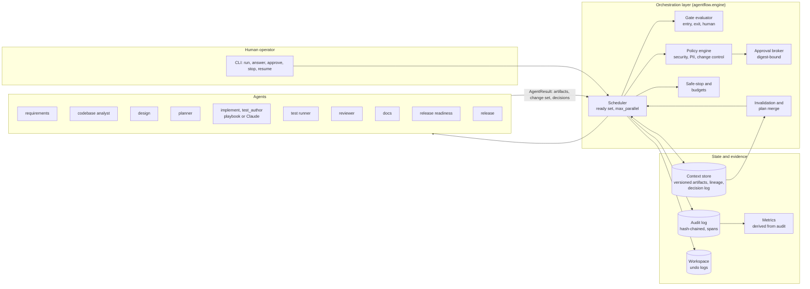
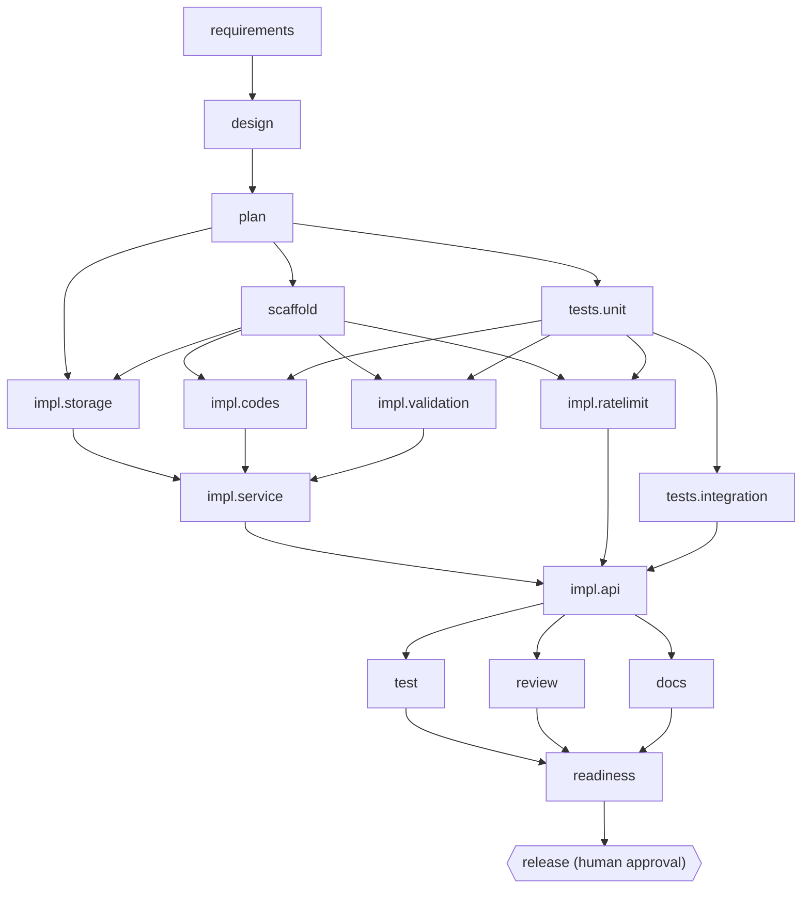
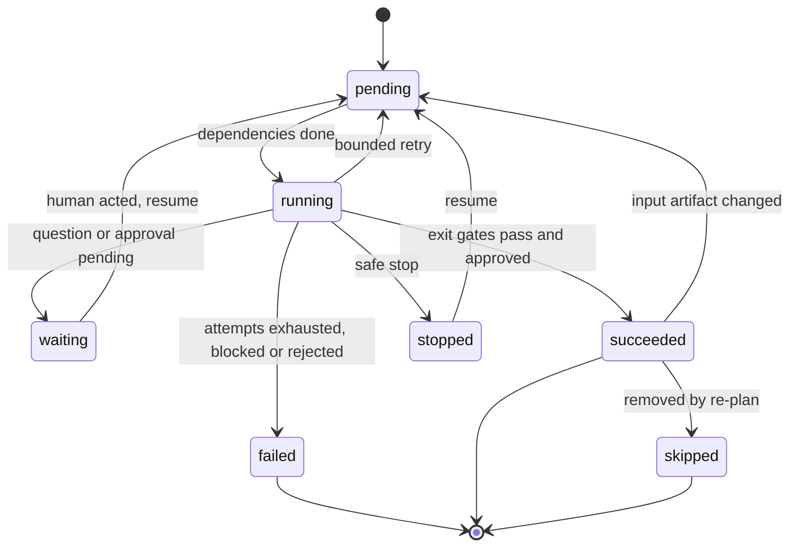

# Architecture

## 1. Components



| Component | Responsibility | Key property |
|---|---|---|
| **Engine** (`engine.py`) | Runs the graph. Owns acceptance of every agent output | Agents never write to the workspace or decide their own success |
| **Graph** (`graph.py`) | Explicit DAG: dependencies, readiness, downstream blocking | Validated acyclic after every plan merge |
| **Gates** (`gates.py`) | Entry gates (may I start?) and exit gates (is the output acceptable?) | Gates run real tools: py_compile, ruff, pytest, coverage, OpenAPI, smoke |
| **Policy** (`policy.py`) | Evaluates each change set *before* it touches disk | Three severities: `block`, `approve`, `warn` |
| **Approvals** (`approvals.py`) | Human checkpoints | Bound to the change's content digest; named human approver required |
| **Context store** (`context.py`) | Versioned artifacts; each version records producer + input versions | Any output can be traced back to the request and the human answers |
| **Audit** (`audit.py`) | Append-only JSONL, SHA-256 chained, trace id = run, span per attempt | `agentflow verify` detects edits and deletions |
| **Workspace** (`workspace.py`) | Applies change sets atomically, confined to the workspace root | Every apply returns an undo log; crash-safe via inflight logs |
| **Metrics** (`metrics.py`) | Success rate, retries, rollbacks, MTTR, latency, approvals, re-plans | Computed from the audit trail, so the numbers can't drift from the evidence |

## 2. Orchestration model

The delivery graph has two layers that live in **one DAG**:

1. **Stage skeleton** (from `scenario.py`, fixed per pipeline):
   `requirements → [analyze] → design → plan → {test, review, docs} → readiness → release`
2. **Task nodes** inserted by the planner at run time (the decomposition), each with its
   own dependencies, declared write set, verification tests and impact.

`test`, `review` and `docs` are **join stages**: after every plan merge their
dependencies are set to "every active task". Implementation therefore fans out in parallel
and synchronises before validation.

Example: the greenfield plan, as actually executed (from `report.md`):



### Node lifecycle



| From | To | When |
|---|---|---|
| pending | running | all dependencies succeeded or were skipped |
| running | waiting | a human gate is open (clarifying question) or an approval is pending |
| waiting | pending | the human answered or decided; picked up on `resume` |
| running | succeeded | exit gates pass (and approval granted, if required) |
| running | pending | retry: bounded attempts with backoff, next candidate or fallback agent |
| running | failed | attempts exhausted, policy block, or approval rejected; downstream nodes become `blocked`, a critical node triggers safe stop |
| running | stopped | safe stop (STOP file, SIGINT, budget); resumable |
| succeeded | pending | an input artifact changed (invalidation) |
| succeeded | skipped | removed by a re-plan (its change is reverted) |

## 3. Control flow of one node

```
entry gates ─ fail(human) ─► WAITING            ─ fail(other) ─► FAILED
    │
    ▼
attempt k  (agent = primary, or fallback on last attempt / provider error)
    │  agent.run() under timeout ──► AgentResult{artifacts, change set, decisions}
    ▼
stage artifacts (versioned, with input lineage)
    ▼
policy.evaluate(change set)  ── block ─► rollback nothing (not applied) ─► retry with feedback
    ▼
[workspace lock]  write inflight undo log → apply (all-or-nothing) → exit gates
    │                      fail ─► rollback + unstage ─► retry with gate output as feedback
    ▼
approval needed? (policy "approve" findings or high-impact node)
    │   pending  ─► keep the verified change parked (pending undo log), WAITING
    │   rejected ─► rollback, FAILED, downstream BLOCKED, safe stop
    ▼   approved ─► (on resume) re-run exit gates, then commit
commit undo log → SUCCEEDED → propagate changed artifacts → maybe merge new plan
```

Notable rules:

* **Humans approve verified changes.** Approval is requested *after* the change has
  passed its gates in the sandbox workspace, with the gate results as evidence. A
  defective first attempt (brownfield, candidate 1) is rolled back without bothering a
  human. Gates are re-run at the moment of approval so stale evidence can't be approved.
* **Approval binds to content.** The key is `node@digest`. If a retry produces a
  different change, the old approval does not apply.
* **Write sets are an autonomy boundary.** An agent can only change the paths its task
  declared (`CHG-003`). Two tasks with overlapping write sets are serialised by the
  planner, like a merge queue.
* **Bounded everything:** per-node attempts (`max_attempts`, at least the number of
  candidates), exponential backoff capped at 2 s, per-run attempt and time budgets, and
  an agent timeout.

## 4. State, re-planning and resumption

Everything that crosses a stage boundary is an **artifact** in the context store:
`requirement_text`, `human_answers`, `requirements`, `impact_analysis`, `design`, `plan`,
`test_report`, `review_report`, `docs`, `release_readiness`, `release`. Each version
records its producer and the versions of its inputs. A node records the input versions it
consumed.

When a node produces a **changed** artifact, every consumer that saw an older version is
**invalidated** (back to pending). A human answer is just a new version of
`human_answers`, so answering a question cascades naturally:

```
human_answers v2 → requirements v2 → impact_analysis v2, design v2 → plan v2
                                                         └─► plan merge
```

The **plan merge** compares the new plan with the live graph task by task:

| Task in new plan vs live graph | Action |
|---|---|
| unchanged spec and deps | **reuse**: keep the result, no re-run (`node.reused`) |
| changed spec | revert its committed change (undo log), then re-run |
| new | add the node |
| no longer present | revert and mark `skipped` (`node.superseded`) |
| can't be reverted safely (a later change touched the same files) | keep it and log a decision for human review |

Join stages, readiness and release are invalidated when tasks are added or changed.

**Persistence**: `state.json` is written atomically (temp file + rename) after every
scheduling step. A crash between *apply* and *commit* leaves an `*.inflight.json` undo
log, which is rolled back on the next `resume`. A change parked for approval keeps a
`*.pending.json` log and is not rolled back.

## 5. Governance and guardrails

| Rule | Severity | What it catches |
|---|---|---|
| SEC-000 | block | Generated Python that doesn't parse |
| SEC-001 | block | Committed secrets (AWS keys, private keys, tokens, hard-coded credentials; obvious fixture placeholders are allowed) |
| SEC-002 | block | `eval`/`exec`, `os.system`, `pickle.loads`, unsafe `yaml.load`, `shell=True`, SQL built by string formatting |
| PII-001 / PII-002 | block | Persisting raw personal identifiers (IP/email columns); using the client IP without hashing |
| CHG-001 | block | Forbidden paths (`.env`, keys, `.git/`, secrets) |
| CHG-003 | block | Writing outside the task's declared write set |
| DEP-001 | block | A dependency not on the allowlist (supply chain) |
| DATA-001 | approve | A DDL change in a file that existed before the run (live data at risk). Detected by comparing SQL literals before and after the change |
| CHG-002 | approve | Modifying a protected file (`pyproject.toml`, CI, deploy) |
| DEP-002 | approve | Adding an allowlisted dependency to an existing project |
| CHG-004 | approve | Change set larger than the review budget (generated files excluded) |
| high-impact node | approve | `release` (and any task declared `impact: high`) |

Safe stop is triggered by: `agentflow stop` / a `STOP` file / SIGINT, an exhausted
attempt or time budget, a failed **critical** node, or a rejected approval. Running
attempts are cancelled, an in-flight change is rolled back, and the run is left
`stopped`/`failed` but resumable.

## 6. Observability

* **Audit trail**: about 30 event types (`attempt.start/end`, `gate.entry/exit`,
  `policy.evaluated/blocked`, `change.applied/rolled_back/reverted`,
  `approval.requested/decided`, `human.answered`, `node.invalidated/reused/superseded`,
  `plan.created/revised`, `run.safe_stop`, …) with `trace_id` (run), `span_id`
  (attempt), actor (`orchestrator`, `agent:<name>`, `human:<name>`) and a SHA-256 hash
  chain.
* **Reliability metrics** (`metrics.json`, `agentflow metrics`):
  * node and attempt success rate
  * retries
  * rollbacks and rollback rate
  * **MTTR**: first failed attempt → next attempt that passes its gates. Human approval
    wait is reported separately.
  * active time vs wall time: e2e latency, with and without time spent waiting on humans
  * per-stage latency, approvals and mean approval wait
  * re-plans, invalidations, reused nodes, policy blocks, LLM tokens
* **Report** (`report.md`): a readable view over the same evidence, including a mermaid
  render of the live graph with node status.

## 7. Key decisions

| Decision | Why | Alternative rejected |
|---|---|---|
| One DAG with planner-inserted task nodes, not a fixed pipeline | Decomposition, parallelism and re-planning live in the same structure the scheduler runs | A linear stage chain (no parallel paths, no partial re-runs) |
| Artifacts as the only cross-stage channel, versioned with lineage | Makes invalidation mechanical and decisions traceable | Shared mutable dict (no lineage, no change detection) |
| Human answers are artifacts | Clarification uses the same invalidation/re-plan path as any upstream change | Special-case "restart from requirements" |
| Approve *after* validation, bind to digest | Humans review evidence, not intentions. Defective attempts never reach them | Approve-then-apply (approvals for code that later fails tests) |
| Workspace mutations under one lock (merge queue) | Validation sees a consistent tree; agent work (LLM calls) still runs in parallel | Per-file locks (tests read across files) |
| Undo logs instead of git for rollback | Per-change, works mid-run, survives crashes, no VCS dependency | `git stash/reset` (whole-tree, interferes with parallel tasks) |
| Deterministic default provider + optional Claude | Reproducible demo and tests. The governance is identical for both | LLM-only (non-reproducible, needs keys to evaluate) |
| Metrics derived from the audit log | One source of truth. Metrics can be recomputed and checked | Separate counters that can disagree with the audit |
