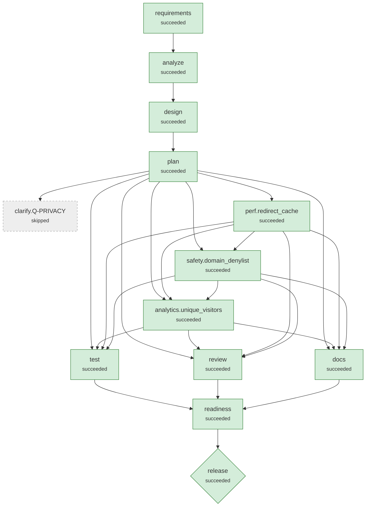

# Run demo-ambiguous-sample

**Scenario:** ambiguous: Product ask: safer links, marketing analytics, fast redirects  
**Status:** `succeeded`  
**Provider:** deterministic · **Playbook:** shortener_v2

## 1. Requirement

```text
Make short links safer and add some analytics so marketing can see how links perform.
Redirects should also be fast.
```

## 2. Requirement understanding

| Capability | Evidence in request | Acceptance criteria |
|---|---|---|
| analytics | Make short links safer and add some analytics so marketing can see how links perform. | Per-link total clicks, daily breakdown and top referrer hosts<br>Click recording never delays the redirect response |
| domain_denylist | Q-SAFETY -> denylist | Targets on a configurable domain denylist (incl. subdomains) are rejected with 400 |
| performance | Redirects should also be fast. | Redirect path meets the agreed latency target |
| redirect | Redirects should also be fast. | GET /{code} returns 302 to the target<br>Unknown codes return 404; deleted or expired codes return 410 |
| redirect_cache | Q-PERF -> p95-50ms | Hot redirects are served from a bounded in-process TTL cache<br>Deleting a link invalidates its cache entry immediately<br>Redirect p95 < 50 ms in-process (perf smoke test) |
| unique_visitors | Q-PRIVACY -> hashed | Stats report unique visitors per link<br>No raw IP address is ever persisted: visitors are a keyed, daily-rotating hash |
| url_safety | Make short links safer and add some analytics so marketing can see how links perform. | Only http(s) targets are accepted; script/data/file schemes are rejected with 400<br>URLs with embedded credentials are rejected |

**Ambiguities detected**

| Id | Trigger | Question | Options | Resolution |
|---|---|---|---|---|
| Q-PRIVACY | Make short links safer and add some analytics so marketing can see how links perform. | Marketing will likely want unique visitors, which needs a per-visitor identifier (IP address). What may we store? | hashed, raw, none | hashed (human:reviewer) |
| Q-PERF | Redirects should also be fast. | 'Fast' has no target. Which latency objective should the redirect path meet? | p95-50ms, p95-10ms | p95-50ms (assumption) |
| Q-SAFETY | Make short links safer and add some analytics so marketing can see how links perform. | 'Safer' could mean several threat models. Which should this change cover? | baseline, denylist, reputation | denylist (assumption) |

**Assumptions**

- Q-PERF: assumed 'p95 < 50 ms in-process (read-through cache, no new infra)' (non-blocking; confirm or override)
- Q-SAFETY: assumed 'Add a configurable domain denylist for known-bad domains' (non-blocking; confirm or override)

## 3. Codebase reasoning (brownfield)

- Import graph: `{'shortener': [], 'shortener.__main__': ['shortener.api'], 'shortener.api': ['shortener', 'shortener.codes', 'shortener.config', 'shortener.db', 'shortener.models', 'shortener.ratelimit', 'shortener.repository', 'shortener.service', 'shortener.validation', 'shortener.web'], 'shortener.cache': [], 'shortener.codes': [], 'shortener.config': [], 'shortener.db': [], 'shortener.models': [], 'shortener.ratelimit': [], 'shortener.repository': ['shortener.db'], 'shortener.service': ['shortener.cache', 'shortener.codes', 'shortener.config', 'shortener.repository', 'shortener.validation'], 'shortener.validation': [], 'shortener.web': []}`
- Blast radius: ['shortener.__main__', 'shortener.api', 'shortener.cache', 'shortener.codes', 'shortener.db', 'shortener.repository', 'shortener.service', 'shortener.validation']
- Data at risk: ['clicks', 'idempotency_keys', 'links', 'schema_migrations']
- Regression tests selected: ['tests/unit/test_codes.py', 'tests/unit/test_service.py', 'tests/unit/test_validation.py']

| Capability | Modules | Routes | Tables |
|---|---|---|---|
| analytics | ['shortener.api', 'shortener.db', 'shortener.repository', 'shortener.service'] | ['GET /api/v1/links/{code}/stats'] | ['clicks', 'idempotency_keys', 'links', 'schema_migrations'] |
| domain_denylist | ['shortener.cache', 'shortener.codes', 'shortener.validation'] | [] | [] |
| performance | [] | [] | [] |
| redirect | ['shortener.api', 'shortener.service'] | ['GET /{code}'] | [] |
| redirect_cache | ['shortener.api', 'shortener.service'] | ['GET /{code}'] | [] |
| unique_visitors | ['shortener.api', 'shortener.db', 'shortener.repository', 'shortener.service'] | ['GET /api/v1/links/{code}/stats'] | ['clicks', 'idempotency_keys', 'links', 'schema_migrations'] |
| url_safety | ['shortener.cache', 'shortener.codes', 'shortener.validation'] | [] | [] |

## 4. Design

Style: modular monolith: api -> service -> repository -> db, pure helpers below

| ADR | Decision | Rationale | Alternatives |
|---|---|---|---|
| ADR-01 | Record clicks after the response; store referrer host + UA family only | Keeps redirect latency independent of analytics writes and minimises personal data. | Synchronous write (simpler, slower); Event queue (scales, more infrastructure) |
| ADR-02 | Configurable domain denylist, matched on registrable suffix | Cheap, deterministic, auditable; reputation APIs add a vendor dependency. | Google Safe Browsing lookup (external dependency, latency) |
| ADR-03 | 302 + Cache-Control: no-store for redirects | Every click must reach the service for analytics; 301 is cached by browsers. | 301 Moved Permanently (cheaper, but under-counts) |
| ADR-04 | Bounded in-process TTL cache on the redirect path | Meets p95 < 50 ms with no new infrastructure; TTL bounds staleness, delete invalidates. | Redis/CDN edge cache (needed only for p95 < 10 ms or multi-instance) |
| ADR-05 | Unique visitors via HMAC(secret, day \| IP \| UA), truncated | Counts uniques per day without storing personal data; the daily key prevents tracking a visitor across days. | Store raw IPs (personal data, needs legal basis); Cookies (consent banner needed) |
| ADR-06 | Validate targets at the boundary; never fetch them | Blocks script schemes, credential spoofing and internal hosts without network I/O. | Fetch-and-inspect targets (SSRF risk, latency) |

## 5. Plan (v2) and decomposition

| Task | Agent | Depends on | Writes | Verified by | Declared impact |
|---|---|---|---|---|---|
| perf.redirect_cache | implement | - | shortener/cache.py, shortener/config.py, shortener/service.py, tests/unit/test_cache.py, tests/integration/test_performance.py | tests, tests/integration/test_performance.py, tests/unit/test_cache.py, tests/unit/test_service.py | low |
| safety.domain_denylist | implement | perf.redirect_cache | shortener/config.py, shortener/validation.py, shortener/service.py, tests/unit/test_denylist.py | tests, tests/unit/test_denylist.py, tests/unit/test_service.py, tests/unit/test_validation.py | low |
| analytics.unique_visitors | implement | perf.redirect_cache, safety.domain_denylist | shortener/db.py, shortener/config.py, shortener/repository.py, shortener/service.py, shortener/models.py, shortener/api.py, tests/unit/test_visitors.py | tests, tests/unit/test_service.py, tests/unit/test_visitors.py | low |

**Traceability (capability → tasks)**

- analytics: ['existing:shortener.api', 'existing:shortener.db', 'existing:shortener.repository', 'existing:shortener.service']
- domain_denylist: ['safety.domain_denylist']
- performance: not covered
- redirect: ['existing:shortener.api', 'existing:shortener.service']
- redirect_cache: ['perf.redirect_cache']
- unique_visitors: ['analytics.unique_visitors']
- url_safety: ['existing:shortener.cache', 'existing:shortener.codes', 'existing:shortener.validation']

## 6. Orchestration graph



Rectangles are stages/tasks; diamonds are high-impact nodes that require human approval.

## 7. Execution

| Node | Kind | Status | Attempts | Runs | Origin | Started | Finished | Note |
|---|---|---|---|---|---|---|---|---|
| requirements | stage | succeeded | 1 | 2 | scenario | 18:36:01 | 18:36:08 |  |
| analyze | stage | succeeded | 1 | 2 | scenario | 18:36:01 | 18:36:08 |  |
| design | stage | succeeded | 1 | 2 | scenario | 18:36:01 | 18:36:08 |  |
| plan | stage | succeeded | 1 | 2 | scenario | 18:36:01 | 18:36:08 |  |
| clarify.Q-PRIVACY | checkpoint | skipped | 1 | 1 | plan:v1 | 18:36:01 | 18:36:08 |  |
| perf.redirect_cache | task | succeeded | 1 | 1 | plan:v1 | 18:36:01 | 18:36:04 |  |
| safety.domain_denylist | task | succeeded | 1 | 1 | plan:v1 | 18:36:04 | 18:36:07 |  |
| analytics.unique_visitors | task | succeeded | 1 | 1 | plan:v2 | 18:36:08 | 18:36:15 |  |
| docs | stage | succeeded | 1 | 1 | scenario | 18:36:15 | 18:36:21 |  |
| review | stage | succeeded | 1 | 1 | scenario | 18:36:15 | 18:36:21 |  |
| test | stage | succeeded | 1 | 1 | scenario | 18:36:15 | 18:36:21 |  |
| readiness | stage | succeeded | 1 | 1 | scenario | 18:36:21 | 18:36:21 |  |
| release | stage | succeeded | 1 | 1 | scenario | 18:36:21 | 18:36:24 |  |

**Timeline (audit trail excerpts)**

- `18:36:01` **run.session.start**  {"status": "created"}
- `18:36:01` **attempt.start** requirements {"attempt": 1, "agent": "requirements"}
- `18:36:01` **agent.note** requirements {"note": "6 capabilities, 3 ambiguities, 1 blocking"}
- `18:36:01` **attempt.start** analyze {"attempt": 1, "agent": "codebase"}
- `18:36:01` **agent.note** analyze {"note": "blast radius ['shortener.__main__', 'shortener.api', 'shortener.codes', 'shortener.db', 'shortener.repository', 'shortener.service', 'shortener.validation'], 0 latent defects, regression tests ['tests/unit/test
- `18:36:01` **attempt.start** design {"attempt": 1, "agent": "design"}
- `18:36:01` **attempt.start** plan {"attempt": 1, "agent": "planner"}
- `18:36:01` **agent.note** plan {"note": "3 tasks; waiting on ['Q-PRIVACY']"}
- `18:36:01` **plan.created** plan {"plan_version": 1, "added": ["perf.redirect_cache", "safety.domain_denylist", "clarify.Q-PRIVACY"], "changed": [], "removed": [], "reused": []}
- `18:36:01` **node.waiting** clarify.Q-PRIVACY {"reason": "waiting for a human answer to Q-PRIVACY: Marketing will likely want unique visitors, which needs a per-visitor identifier (IP address). What may we store? options=['hashed', 'raw', 'none']"}
- `18:36:01` **attempt.start** perf.redirect_cache {"attempt": 1, "agent": "implement"}
- `18:36:01` **agent.note** perf.redirect_cache {"note": "candidate 1/1: Q-PERF: bounded TTL read-through cache on the redirect path (p95 < 50 ms)"}
- `18:36:01` **change.applied** perf.redirect_cache {"digest": "b66d33867eaf4558", "summary": "Q-PERF: bounded TTL read-through cache on the redirect path (p95 < 50 ms)", "candidate": 0, "paths": ["shortener/cache.py", "shortener/config.py", "shortener/service.py", "tests
- `18:36:04` **attempt.start** safety.domain_denylist {"attempt": 1, "agent": "implement"}
- `18:36:04` **agent.note** safety.domain_denylist {"note": "candidate 1/1: Q-SAFETY: configurable domain denylist (incl. subdomains)"}
- `18:36:04` **change.applied** safety.domain_denylist {"digest": "899cd9288451a480", "summary": "Q-SAFETY: configurable domain denylist (incl. subdomains)", "candidate": 0, "paths": ["shortener/config.py", "shortener/service.py", "shortener/validation.py", "tests/unit/test_
- `18:36:07` **run.session.end**  {"status": "waiting", "stop_reason": null, "waiting": ["clarify.Q-PRIVACY"]}
- `18:36:07` **human.answered**  {"question": "Q-PRIVACY", "option": "hashed"}
- `18:36:07` **node.invalidated** requirements {"reason": "input 'human_answers' changed to v2"}
- `18:36:08` **run.session.start**  {"status": "waiting"}
- `18:36:08` **attempt.start** requirements {"attempt": 1, "agent": "requirements"}
- `18:36:08` **agent.note** requirements {"note": "7 capabilities, 3 ambiguities, 0 blocking"}
- `18:36:08` **node.invalidated** analyze {"reason": "input 'requirements' changed to v2"}
- `18:36:08` **node.invalidated** design {"reason": "input 'requirements' changed to v2"}
- `18:36:08` **node.invalidated** plan {"reason": "input 'requirements' changed to v2"}
- `18:36:08` **attempt.start** analyze {"attempt": 1, "agent": "codebase"}
- `18:36:08` **agent.note** analyze {"note": "blast radius ['shortener.__main__', 'shortener.api', 'shortener.cache', 'shortener.codes', 'shortener.db', 'shortener.repository', 'shortener.service', 'shortener.validation'], 0 latent defects, regression test
- `18:36:08` **attempt.start** design {"attempt": 1, "agent": "design"}
- `18:36:08` **attempt.start** plan {"attempt": 1, "agent": "planner"}
- `18:36:08` **agent.note** plan {"note": "3 tasks; waiting on nothing"}
- `18:36:08` **node.reused** perf.redirect_cache {"plan_version": 2}
- `18:36:08` **node.reused** safety.domain_denylist {"plan_version": 2}
- `18:36:08` **node.superseded** clarify.Q-PRIVACY {"plan_version": 2}
- `18:36:08` **plan.revised** plan {"plan_version": 2, "added": ["analytics.unique_visitors"], "changed": [], "removed": ["clarify.Q-PRIVACY"], "reused": ["perf.redirect_cache", "safety.domain_denylist"]}
- `18:36:08` **attempt.start** analytics.unique_visitors {"attempt": 1, "agent": "implement"}
- `18:36:08` **agent.note** analytics.unique_visitors {"note": "candidate 1/1: Q-PRIVACY=hashed: unique visitors via daily-rotating HMAC; raw IPs never stored"}
- `18:36:08` **change.applied** analytics.unique_visitors {"digest": "00b8c77278ed0a10", "summary": "Q-PRIVACY=hashed: unique visitors via daily-rotating HMAC; raw IPs never stored", "candidate": 0, "paths": ["shortener/api.py", "shortener/config.py", "shortener/db.py", "shorte
- `18:36:11` **approval.requested** analytics.unique_visitors {"subject": "00b8c77278ed0a10", "reasons": ["DATA-001 shortener/db.py: schema change against an existing database"]}
- `18:36:11` **node.waiting** analytics.unique_visitors {"reason": "approval required: DATA-001 shortener/db.py: schema change against an existing database"}
- `18:36:11` **run.session.end**  {"status": "waiting", "stop_reason": null, "waiting": ["analytics.unique_visitors"]}
- `18:36:11` **approval.decided** analytics.unique_visitors {"subject": "00b8c77278ed0a10", "status": "approved", "by": "reviewer", "comment": "no raw IPs; additive migration", "decided_at": 1791311771.9824035, "waited_s": 0.4}
- `18:36:12` **run.session.start**  {"status": "waiting"}
- `18:36:15` **attempt.start** docs {"attempt": 1, "agent": "docs"}
- `18:36:15` **attempt.start** review {"attempt": 1, "agent": "reviewer"}
- `18:36:15` **attempt.start** test {"attempt": 1, "agent": "test_runner"}
- `18:36:16` **agent.note** review {"note": "0 lint, 0 security, 0 latent defects (reported, non-blocking)"}
- `18:36:21` **agent.note** test {"note": "79 passed, 0 failed, coverage 96.9%"}
- `18:36:21` **change.applied** docs {"digest": "0eed41da716b12bf", "summary": "Generate API reference, design record, changelog", "candidate": 0, "paths": ["CHANGELOG.md", "docs/API.md", "docs/DESIGN.md", "openapi.json"], "added": 955, "removed": 0}
- `18:36:21` **attempt.start** readiness {"attempt": 1, "agent": "release_readiness"}
- `18:36:21` **agent.note** readiness {"note": "ready=True, 2 residual risks"}
- `18:36:21` **attempt.start** release {"attempt": 1, "agent": "release"}
- `18:36:21` **change.applied** release {"digest": "a4a9f67a307d98b2", "summary": "Release 1.1.0", "candidate": 0, "paths": ["RELEASE_NOTES.md", "VERSION", "pyproject.toml"], "added": 25, "removed": 1}
- `18:36:22` **approval.requested** release {"subject": "a4a9f67a307d98b2", "reasons": ["high-impact stage 'release'", "CHG-002 pyproject.toml: modifies a protected file"]}
- `18:36:22` **node.waiting** release {"reason": "approval required: high-impact stage 'release'; CHG-002 pyproject.toml: modifies a protected file"}
- `18:36:22` **run.session.end**  {"status": "waiting", "stop_reason": null, "waiting": ["release"]}
- `18:36:23` **approval.decided** release {"subject": "a4a9f67a307d98b2", "status": "approved", "by": "reviewer", "comment": "", "decided_at": 1791311783.0788414, "waited_s": 0.4}
- `18:36:23` **run.session.start**  {"status": "waiting"}
- `18:36:24` **run.session.end**  {"status": "succeeded", "stop_reason": null, "waiting": []}

## 8. Validation gates

| Node | Type | Gate | Result | Detail |
|---|---|---|---|---|
| requirements | exit | requirements_valid | pass | 6 capabilities, all with acceptance criteria |
| design | exit | design_covers_requirements | pass | every capability has a design element |
| plan | exit | plan_valid | pass | 3 tasks; every capability traced to >=1 task |
| clarify.Q-PRIVACY | entry | clarified:Q-PRIVACY | FAIL | waiting for a human answer to Q-PRIVACY: Marketing will likely want unique visitors, which needs a per-visitor identifier (IP address). What may we st |
| perf.redirect_cache | exit | compiles | pass | 5 files compile |
| perf.redirect_cache | exit | lint | pass | ruff clean |
| perf.redirect_cache | exit | tests | pass | ['tests', 'tests/integration/test_performance.py', 'tests/unit/test_cache.py', 'tests/unit/test_service.py']: 70 passed in 2.26s |
| safety.domain_denylist | exit | compiles | pass | 4 files compile |
| safety.domain_denylist | exit | lint | pass | ruff clean |
| safety.domain_denylist | exit | tests | pass | ['tests', 'tests/unit/test_denylist.py', 'tests/unit/test_service.py', 'tests/unit/test_validation.py']: 76 passed in 2.20s |
| requirements | exit | requirements_valid | pass | 7 capabilities, all with acceptance criteria |
| clarify.Q-PRIVACY | entry | clarified:Q-PRIVACY | pass | Q-PRIVACY answered |
| design | exit | design_covers_requirements | pass | every capability has a design element |
| plan | exit | plan_valid | pass | 3 tasks; every capability traced to >=1 task |
| analytics.unique_visitors | exit | compiles | pass | 7 files compile |
| analytics.unique_visitors | exit | lint | pass | ruff clean |
| analytics.unique_visitors | exit | tests | pass | ['tests', 'tests/unit/test_service.py', 'tests/unit/test_visitors.py']: 79 passed in 2.42s |
| analytics.unique_visitors | exit | compiles | pass | 7 files compile |
| analytics.unique_visitors | exit | lint | pass | ruff clean |
| analytics.unique_visitors | exit | tests | pass | ['tests', 'tests/unit/test_service.py', 'tests/unit/test_visitors.py']: 79 passed in 2.59s |
| docs | exit | openapi_valid | pass | 7 operations; all designed endpoints present |
| docs | exit | docs_complete | pass | 4 docs written |
| review | exit | lint_clean | pass | no lint issues |
| review | exit | security_clean | pass | no security findings |
| test | exit | tests_pass | pass | 79 passed, 0 failed, 0 errors |
| test | exit | coverage_min | pass | coverage 96.9% (min 90.0%) |
| readiness | exit | readiness | pass | all release checks pass |
| release | exit | smoke | pass | ok GET /readyz -> 200 ok POST /api/v1/links -> 201 ok GET /Pd35qMu -> 302 ok GET /api/v1/links/Pd35qMu/stats -> 200 |
| release | exit | smoke | pass | ok GET /readyz -> 200 ok POST /api/v1/links -> 201 ok GET /gMzZR1m -> 302 ok GET /api/v1/links/gMzZR1m/stats -> 200 |

## 9. Policy guardrails

| Node | Rule | Severity | Path | Message |
|---|---|---|---|---|
| analytics.unique_visitors | DATA-001 | approve | shortener/db.py | schema change against an existing database |
| release | CHG-002 | approve | pyproject.toml | modifies a protected file |

## 10. Human approvals

| Node | Subject | Reasons | Decision | By | Waited (s) |
|---|---|---|---|---|---|
| analytics.unique_visitors | 00b8c77278ed0a10 | DATA-001 shortener/db.py: schema change against an existing database | approved | reviewer | 0.4 |
| release | a4a9f67a307d98b2 | high-impact stage 'release'<br>CHG-002 pyproject.toml: modifies a protected file | approved | reviewer | 0.4 |

## 11. Decision log (lineage)

| Id | Node | By | Decision | Rationale | Inputs |
|---|---|---|---|---|---|
| D001 | requirements | assumption | Q-PERF resolved as 'p95-50ms' | p95 < 50 ms in-process (read-through cache, no new infra) | {'requirement_text': 1, 'human_answers': 1} |
| D002 | requirements | assumption | Q-SAFETY resolved as 'denylist' | Add a configurable domain denylist for known-bad domains | {'requirement_text': 1, 'human_answers': 1} |
| D003 | design | agent | Record clicks after the response; store referrer host + UA family only | Keeps redirect latency independent of analytics writes and minimises personal data. | {'requirements': 1, 'impact_analysis': 1} |
| D004 | design | agent | Configurable domain denylist, matched on registrable suffix | Cheap, deterministic, auditable; reputation APIs add a vendor dependency. | {'requirements': 1, 'impact_analysis': 1} |
| D005 | design | agent | 302 + Cache-Control: no-store for redirects | Every click must reach the service for analytics; 301 is cached by browsers. | {'requirements': 1, 'impact_analysis': 1} |
| D006 | design | agent | Bounded in-process TTL cache on the redirect path | Meets p95 < 50 ms with no new infrastructure; TTL bounds staleness, delete invalidates. | {'requirements': 1, 'impact_analysis': 1} |
| D007 | design | agent | Validate targets at the boundary; never fetch them | Blocks script schemes, credential spoofing and internal hosts without network I/O. | {'requirements': 1, 'impact_analysis': 1} |
| D008 | plan | agent | Serialise safety.domain_denylist after perf.redirect_cache | Both change ['shortener/config.py', 'shortener/service.py']; running them in parallel could produce conflicting edits, so they are ordered like a merge queue. | {'requirements': 1, 'impact_analysis': 1, 'design': 1} |
| D009 | plan | agent | No new work for ['analytics', 'redirect', 'url_safety'] | Static analysis shows the existing code already implements these: analytics in ['shortener.api', 'shortener.db', 'shortener.repository', 'shortener.service']; redirect in ['shortener.api', 'shortener.service']; url_safety in ['shortener.codes', 'shortener.validation'] | {'requirements': 1, 'impact_analysis': 1, 'design': 1} |
| D010 | requirements | human:reviewer | Q-PRIVACY answered: hashed | human clarification | {} |
| D011 | requirements | human:reviewer | Q-PRIVACY resolved as 'hashed' | Daily-rotating keyed hash of IP+UA; raw IP never stored | {'requirement_text': 1, 'human_answers': 2} |
| D012 | requirements | assumption | Q-PERF resolved as 'p95-50ms' | p95 < 50 ms in-process (read-through cache, no new infra) | {'requirement_text': 1, 'human_answers': 2} |
| D013 | requirements | assumption | Q-SAFETY resolved as 'denylist' | Add a configurable domain denylist for known-bad domains | {'requirement_text': 1, 'human_answers': 2} |
| D014 | design | agent | Record clicks after the response; store referrer host + UA family only | Keeps redirect latency independent of analytics writes and minimises personal data. | {'requirements': 2, 'impact_analysis': 2} |
| D015 | design | agent | Configurable domain denylist, matched on registrable suffix | Cheap, deterministic, auditable; reputation APIs add a vendor dependency. | {'requirements': 2, 'impact_analysis': 2} |
| D016 | design | agent | 302 + Cache-Control: no-store for redirects | Every click must reach the service for analytics; 301 is cached by browsers. | {'requirements': 2, 'impact_analysis': 2} |
| D017 | design | agent | Bounded in-process TTL cache on the redirect path | Meets p95 < 50 ms with no new infrastructure; TTL bounds staleness, delete invalidates. | {'requirements': 2, 'impact_analysis': 2} |
| D018 | design | agent | Unique visitors via HMAC(secret, day \| IP \| UA), truncated | Counts uniques per day without storing personal data; the daily key prevents tracking a visitor across days. | {'requirements': 2, 'impact_analysis': 2} |
| D019 | design | agent | Validate targets at the boundary; never fetch them | Blocks script schemes, credential spoofing and internal hosts without network I/O. | {'requirements': 2, 'impact_analysis': 2} |
| D020 | plan | agent | Serialise safety.domain_denylist after perf.redirect_cache | Both change ['shortener/config.py', 'shortener/service.py']; running them in parallel could produce conflicting edits, so they are ordered like a merge queue. | {'requirements': 2, 'impact_analysis': 2, 'design': 2} |
| D021 | plan | agent | Serialise analytics.unique_visitors after perf.redirect_cache | Both change ['shortener/config.py', 'shortener/service.py']; running them in parallel could produce conflicting edits, so they are ordered like a merge queue. | {'requirements': 2, 'impact_analysis': 2, 'design': 2} |
| D022 | plan | agent | Serialise analytics.unique_visitors after safety.domain_denylist | Both change ['shortener/config.py', 'shortener/service.py']; running them in parallel could produce conflicting edits, so they are ordered like a merge queue. | {'requirements': 2, 'impact_analysis': 2, 'design': 2} |
| D023 | plan | agent | No new work for ['analytics', 'redirect', 'url_safety'] | Static analysis shows the existing code already implements these: analytics in ['shortener.api', 'shortener.db', 'shortener.repository', 'shortener.service']; redirect in ['shortener.api', 'shortener.service']; url_safety in ['shortener.cache', 'shortener.codes', 'shortener.validation'] | {'requirements': 2, 'impact_analysis': 2, 'design': 2} |
| D024 | plan | orchestrator | Re-plan to v2 | upstream change; added ['analytics.unique_visitors'], changed [], removed ['clarify.Q-PRIVACY'], kept ['perf.redirect_cache', 'safety.domain_denylist'] without re-running | {} |

### test_report

```json
{
 "passed": 79,
 "failed": 0,
 "errors": 0,
 "skipped": 0,
 "total": 79,
 "ok": true,
 "coverage": 96.9,
 "failures": []
}
```

### review_report

```json
{
 "lint": [],
 "security": [],
 "latent_defects": []
}
```

### release_readiness

```json
{
 "checks": [
  {
   "check": "all tests pass",
   "passed": true,
   "detail": "79 passed / 0 failed"
  },
  {
   "check": "coverage >= 90%",
   "passed": true,
   "detail": "96.9%"
  },
  {
   "check": "lint clean",
   "passed": true,
   "detail": "0 issues"
  },
  {
   "check": "no security findings",
   "passed": true,
   "detail": "0 findings"
  },
  {
   "check": "docs generated",
   "passed": true,
   "detail": "openapi.json, docs/API.md, docs/DESIGN.md, CHANGELOG.md"
  },
  {
   "check": "no blocking questions open",
   "passed": true,
   "detail": "[]"
  }
 ],
 "ready": true,
 "residual_risks": [
  "assumption: Q-PERF: assumed 'p95 < 50 ms in-process (read-through cache, no new infra)' (non-blocking; confirm or override)",
  "assumption: Q-SAFETY: assumed 'Add a configurable domain denylist for known-bad domains' (non-blocking; confirm or override)"
 ]
}
```

## 12. Artifact lineage

Provenance of `release`:

- release v1 ← release
  - plan v2 ← plan
    - design v2 ← design
      - impact_analysis v2 ← analyze
        - requirements v2 ← requirements
          - human_answers v2 ← human:reviewer
          - requirement_text v1 ← scenario
  - release_readiness v1 ← readiness
    - docs v1 ← docs
    - review_report v1 ← review
    - test_report v1 ← test

## 13. Reliability metrics

| Metric | Value |
|---|---|
| nodes_succeeded | 13 |
| nodes_failed | 0 |
| node_success_rate | 1.0 |
| attempts | 14 |
| attempt_success_rate | 1.0 |
| retries | 0 |
| changes_applied | 5 |
| rollbacks | 0 |
| rollback_rate | 0.0 |
| mttr_s | None |
| recoveries | 0 |
| replans | 1 |
| invalidations | 4 |
| reused_nodes | 2 |
| policy_blocks | 0 |
| approvals | 2 |
| approval_wait_s | 0.4 |
| active_time_s | 20.587 |
| wall_time_s | 22.671 |
| sessions | 4 |
| llm_tokens | 0 |

Audit chain: **verified** (128 records, chain intact).

## 14. Change sets

Every applied change (including rolled-back attempts) is kept in `changes/`:

- `changes/analytics.unique_visitors.a1.diff`
- `changes/docs.a1.diff`
- `changes/perf.redirect_cache.a1.diff`
- `changes/release.a1.diff`
- `changes/safety.domain_denylist.a1.diff`
