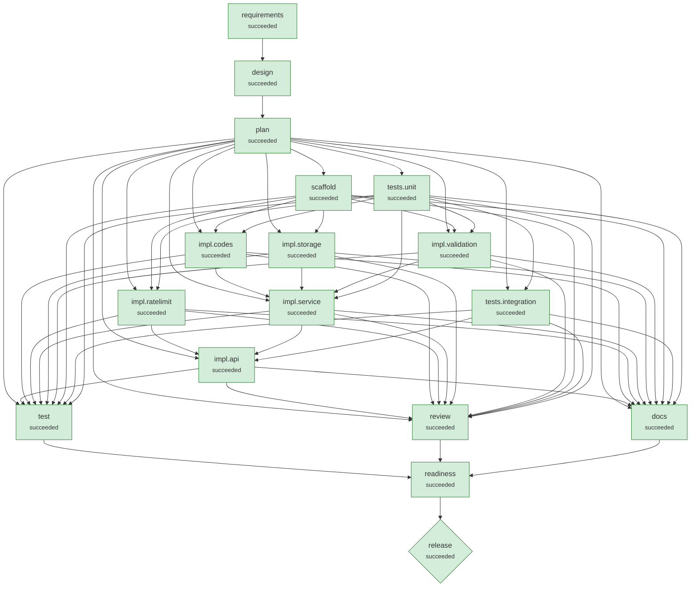

# Run demo-greenfield-sample

**Scenario:** greenfield: URL shortener service, from scratch  
**Status:** `succeeded`  
**Provider:** deterministic · **Playbook:** shortener

## 1. Requirement

```text
Build a URL shortener service with a versioned REST API.
Authenticated clients (API key) can create short links for http/https URLs, optionally with a custom alias and an expiry time.
Visiting a short link must redirect to the target; unknown links return 404 and deleted or expired links return 410.
Owners can view link details, delete links and see click analytics: total clicks, clicks per day and top referrer hosts.
Store no IP addresses or other personal data for analytics.
Reject unsafe targets such as javascript: URLs, embedded credentials and internal hosts.
Rate limit link creation per API key (60 per minute) and make creation safe to retry with an idempotency key.
Expose health and readiness endpoints and propagate a request id on every response.
```

## 2. Requirement understanding

| Capability | Evidence in request | Acceptance criteria |
|---|---|---|
| analytics | Owners can view link details, delete links and see click analytics: total clicks, clicks per day and top referrer hosts. | Per-link total clicks, daily breakdown and top referrer hosts<br>Click recording never delays the redirect response |
| custom_alias | Authenticated clients (API key) can create short links for http/https URLs, optionally with a custom alias and an expiry time. | Aliases are 3-32 chars [A-Za-z0-9_-] and cannot shadow service routes<br>A taken alias returns 409 |
| expiry | Authenticated clients (API key) can create short links for http/https URLs, optionally with a custom alias and an expiry time. | Links may carry an optional expiry in the future<br>Expired links return 410 Gone |
| link_creation | Build a URL shortener service with a versioned REST API. | POST /api/v1/links returns 201 with code and short_url<br>Generated codes are random base62, not sequential or enumerable<br>Code collisions are retried transparently |
| rate_limiting | Rate limit link creation per API key (60 per minute) and make creation safe to retry with an idempotency key. | Link creation is limited per API key; excess returns 429 + Retry-After |
| redirect | Visiting a short link must redirect to the target; unknown links return 404 and deleted or expired links return 410. | GET /{code} returns 302 to the target<br>Unknown codes return 404; deleted or expired codes return 410 |
| reliability | Rate limit link creation per API key (60 per minute) and make creation safe to retry with an idempotency key. | Create is safe to retry with Idempotency-Key<br>/healthz (liveness) and /readyz (DB check) endpoints<br>Every response carries X-Request-ID |
| url_safety | Reject unsafe targets such as javascript: URLs, embedded credentials and internal hosts. | Only http(s) targets are accepted; script/data/file schemes are rejected with 400<br>URLs with embedded credentials are rejected |

## 4. Design

Style: modular monolith: api -> service -> repository -> db, pure helpers below

| ADR | Decision | Rationale | Alternatives |
|---|---|---|---|
| ADR-01 | Record clicks after the response; store referrer host + UA family only | Keeps redirect latency independent of analytics writes and minimises personal data. | Synchronous write (simpler, slower); Event queue (scales, more infrastructure) |
| ADR-02 | Expiry evaluated at read time; 410 Gone | No background job required; expired rows remain for audit/analytics. | Background purge job |
| ADR-03 | Random base62 codes (7 chars) with collision retry | 62^7 ≈ 3.5e12 codes; random codes cannot be enumerated, unlike sequential ids. | Sequential id + base62 (enumerable); Hash of URL (dedup, but leaks equality) |
| ADR-04 | In-process token bucket keyed by API-key owner | Zero infrastructure for a single instance; swap for Redis when horizontally scaled. | Redis sliding window (multi-instance); API gateway limits |
| ADR-05 | 302 + Cache-Control: no-store for redirects | Every click must reach the service for analytics; 301 is cached by browsers. | 301 Moved Permanently (cheaper, but under-counts) |
| ADR-06 | SQLite (WAL) for the prototype behind a repository interface | Single-file, zero-ops, transactional; the repository boundary allows Postgres later. | PostgreSQL now (more ops for a prototype); Redis (weak durability) |
| ADR-07 | Validate targets at the boundary; never fetch them | Blocks script schemes, credential spoofing and internal hosts without network I/O. | Fetch-and-inspect targets (SSRF risk, latency) |

## 5. Plan (v1) and decomposition

| Task | Agent | Depends on | Writes | Verified by | Declared impact |
|---|---|---|---|---|---|
| scaffold | implement | - | pyproject.toml, shortener/__init__.py, shortener/config.py, shortener/__main__.py | - | low |
| tests.unit | test_author | - | tests/__init__.py, tests/conftest.py, tests/unit/__init__.py, tests/unit/test_codes.py, tests/unit/test_validation.py, tests/unit/test_ratelimit.py, tests/unit/test_service.py | - | low |
| tests.integration | test_author | tests.unit | tests/integration/__init__.py, tests/integration/test_api.py | - | low |
| impl.codes | implement | scaffold, tests.unit | shortener/codes.py | tests/unit/test_codes.py | low |
| impl.validation | implement | scaffold, tests.unit | shortener/validation.py | tests/unit/test_validation.py | low |
| impl.ratelimit | implement | scaffold, tests.unit | shortener/ratelimit.py | tests/unit/test_ratelimit.py | low |
| impl.storage | implement | scaffold | shortener/db.py, shortener/repository.py | - | low |
| impl.service | implement | impl.codes, impl.storage, impl.validation, tests.unit | shortener/service.py | tests/unit/test_service.py | low |
| impl.api | implement | impl.ratelimit, impl.service, tests.integration | shortener/models.py, shortener/api.py, shortener/web.py | tests | low |

**Traceability (capability → tasks)**

- analytics: ['tests.unit', 'tests.integration', 'impl.storage', 'impl.service', 'impl.api']
- custom_alias: ['tests.unit', 'impl.codes', 'impl.service']
- expiry: ['tests.unit', 'impl.storage', 'impl.service']
- link_creation: ['tests.unit', 'tests.integration', 'impl.codes', 'impl.storage', 'impl.service', 'impl.api']
- rate_limiting: ['tests.unit', 'tests.integration', 'impl.ratelimit']
- redirect: ['tests.integration', 'impl.api']
- reliability: ['tests.integration', 'impl.service', 'impl.api']
- url_safety: ['tests.unit', 'impl.validation']

## 6. Orchestration graph



Rectangles are stages/tasks; diamonds are high-impact nodes that require human approval.

## 7. Execution

| Node | Kind | Status | Attempts | Runs | Origin | Started | Finished | Note |
|---|---|---|---|---|---|---|---|---|
| requirements | stage | succeeded | 1 | 1 | scenario | 18:35:35 | 18:35:35 |  |
| design | stage | succeeded | 1 | 1 | scenario | 18:35:35 | 18:35:35 |  |
| plan | stage | succeeded | 1 | 1 | scenario | 18:35:35 | 18:35:35 |  |
| scaffold | task | succeeded | 1 | 1 | plan:v1 | 18:35:35 | 18:35:35 |  |
| tests.unit | task | succeeded | 1 | 1 | plan:v1 | 18:35:35 | 18:35:35 |  |
| impl.storage | task | succeeded | 1 | 1 | plan:v1 | 18:35:35 | 18:35:35 |  |
| impl.codes | task | succeeded | 1 | 1 | plan:v1 | 18:35:35 | 18:35:36 |  |
| impl.ratelimit | task | succeeded | 1 | 1 | plan:v1 | 18:35:35 | 18:35:36 |  |
| impl.validation | task | succeeded | 1 | 1 | plan:v1 | 18:35:35 | 18:35:37 |  |
| tests.integration | task | succeeded | 1 | 1 | plan:v1 | 18:35:35 | 18:35:37 |  |
| impl.service | task | succeeded | 1 | 1 | plan:v1 | 18:35:37 | 18:35:38 |  |
| impl.api | task | succeeded | 1 | 1 | plan:v1 | 18:35:38 | 18:35:40 |  |
| docs | stage | succeeded | 1 | 1 | scenario | 18:35:40 | 18:35:44 |  |
| review | stage | succeeded | 1 | 1 | scenario | 18:35:40 | 18:35:44 |  |
| test | stage | succeeded | 1 | 1 | scenario | 18:35:40 | 18:35:44 |  |
| readiness | stage | succeeded | 1 | 1 | scenario | 18:35:44 | 18:35:44 |  |
| release | stage | succeeded | 1 | 1 | scenario | 18:35:44 | 18:35:47 |  |

**Timeline (audit trail excerpts)**

- `18:35:35` **run.session.start**  {"status": "created"}
- `18:35:35` **attempt.start** requirements {"attempt": 1, "agent": "requirements"}
- `18:35:35` **agent.note** requirements {"note": "8 capabilities, 0 ambiguities, 0 blocking"}
- `18:35:35` **attempt.start** design {"attempt": 1, "agent": "design"}
- `18:35:35` **attempt.start** plan {"attempt": 1, "agent": "planner"}
- `18:35:35` **agent.note** plan {"note": "9 tasks; waiting on nothing"}
- `18:35:35` **plan.created** plan {"plan_version": 1, "added": ["scaffold", "tests.unit", "tests.integration", "impl.codes", "impl.validation", "impl.ratelimit", "impl.storage", "impl.service", "impl.api"], "changed": [], "removed": [], "reused": []}
- `18:35:35` **attempt.start** scaffold {"attempt": 1, "agent": "implement"}
- `18:35:35` **agent.note** scaffold {"note": "candidate 1/1: Project scaffold, configuration and entry point"}
- `18:35:35` **change.applied** scaffold {"digest": "6b0caa904985bc9a", "summary": "Project scaffold, configuration and entry point", "candidate": 0, "paths": ["pyproject.toml", "shortener/__init__.py", "shortener/__main__.py", "shortener/config.py"], "added": 
- `18:35:35` **attempt.start** tests.unit {"attempt": 1, "agent": "test_author"}
- `18:35:35` **agent.note** tests.unit {"note": "candidate 1/1: Unit tests from acceptance criteria (codes, validation, rate limit, service)"}
- `18:35:35` **change.applied** tests.unit {"digest": "9f684a0454194fbf", "summary": "Unit tests from acceptance criteria (codes, validation, rate limit, service)", "candidate": 0, "paths": ["tests/__init__.py", "tests/conftest.py", "tests/unit/__init__.py", "tes
- `18:35:35` **attempt.start** impl.storage {"attempt": 1, "agent": "implement"}
- `18:35:35` **agent.note** impl.storage {"note": "candidate 1/1: SQLite schema, migrations and link/click repository"}
- `18:35:35` **change.applied** impl.storage {"digest": "b4a3f71415407e20", "summary": "SQLite schema, migrations and link/click repository", "candidate": 0, "paths": ["shortener/db.py", "shortener/repository.py"], "added": 222, "removed": 0}
- `18:35:35` **attempt.start** impl.codes {"attempt": 1, "agent": "implement"}
- `18:35:35` **agent.note** impl.codes {"note": "candidate 1/1: Random base62 code generator and custom-alias rules"}
- `18:35:35` **attempt.start** impl.ratelimit {"attempt": 1, "agent": "implement"}
- `18:35:35` **agent.note** impl.ratelimit {"note": "candidate 1/1: Token-bucket rate limiter with bounded memory"}
- `18:35:35` **attempt.start** impl.validation {"attempt": 1, "agent": "implement"}
- `18:35:35` **agent.note** impl.validation {"note": "candidate 1/1: Target-URL validation (scheme allowlist, credentials, private hosts, loops)"}
- `18:35:35` **change.applied** impl.codes {"digest": "d4ee7958b5f3301d", "summary": "Random base62 code generator and custom-alias rules", "candidate": 0, "paths": ["shortener/codes.py"], "added": 28, "removed": 0}
- `18:35:35` **attempt.start** tests.integration {"attempt": 1, "agent": "test_author"}
- `18:35:35` **agent.note** tests.integration {"note": "candidate 1/1: API contract tests (status codes, auth, ownership, idempotency, rate limit)"}
- `18:35:36` **change.applied** impl.ratelimit {"digest": "c86b31567aba8a21", "summary": "Token-bucket rate limiter with bounded memory", "candidate": 0, "paths": ["shortener/ratelimit.py"], "added": 47, "removed": 0}
- `18:35:36` **change.applied** impl.validation {"digest": "3f74dac62e455793", "summary": "Target-URL validation (scheme allowlist, credentials, private hosts, loops)", "candidate": 0, "paths": ["shortener/validation.py"], "added": 60, "removed": 0}
- `18:35:37` **change.applied** tests.integration {"digest": "75df1d3d7d41a783", "summary": "API contract tests (status codes, auth, ownership, idempotency, rate limit)", "candidate": 0, "paths": ["tests/integration/__init__.py", "tests/integration/test_api.py"], "added
- `18:35:37` **attempt.start** impl.service {"attempt": 1, "agent": "implement"}
- `18:35:37` **agent.note** impl.service {"note": "candidate 1/1: Link service (create/resolve/delete/stats, idempotency, expiry, ownership)"}
- `18:35:37` **change.applied** impl.service {"digest": "b09723e4786814c1", "summary": "Link service (create/resolve/delete/stats, idempotency, expiry, ownership)", "candidate": 0, "paths": ["shortener/service.py"], "added": 171, "removed": 0}
- `18:35:38` **attempt.start** impl.api {"attempt": 1, "agent": "implement"}
- `18:35:38` **agent.note** impl.api {"note": "candidate 1/1: HTTP API, auth, error mapping, request IDs, health/readiness"}
- `18:35:38` **change.applied** impl.api {"digest": "3f9aed7a962bd9ba", "summary": "HTTP API, auth, error mapping, request IDs, health/readiness", "candidate": 0, "paths": ["shortener/api.py", "shortener/models.py", "shortener/web.py"], "added": 328, "removed":
- `18:35:40` **attempt.start** docs {"attempt": 1, "agent": "docs"}
- `18:35:40` **attempt.start** review {"attempt": 1, "agent": "reviewer"}
- `18:35:40` **attempt.start** test {"attempt": 1, "agent": "test_runner"}
- `18:35:41` **agent.note** review {"note": "0 lint, 0 security, 0 latent defects (reported, non-blocking)"}
- `18:35:44` **agent.note** test {"note": "64 passed, 0 failed, coverage 96.4%"}
- `18:35:44` **change.applied** docs {"digest": "3d892772e990bfe6", "summary": "Generate API reference, design record, changelog", "candidate": 0, "paths": ["CHANGELOG.md", "README.md", "docs/API.md", "docs/DESIGN.md", "openapi.json"], "added": 1011, "remov
- `18:35:44` **attempt.start** readiness {"attempt": 1, "agent": "release_readiness"}
- `18:35:44` **agent.note** readiness {"note": "ready=True, 0 residual risks"}
- `18:35:44` **attempt.start** release {"attempt": 1, "agent": "release"}
- `18:35:44` **change.applied** release {"digest": "96eeea810db51dd1", "summary": "Release 1.0.0", "candidate": 0, "paths": ["RELEASE_NOTES.md", "VERSION"], "added": 25, "removed": 0}
- `18:35:45` **approval.requested** release {"subject": "96eeea810db51dd1", "reasons": ["high-impact stage 'release'"]}
- `18:35:45` **node.waiting** release {"reason": "approval required: high-impact stage 'release'"}
- `18:35:45` **run.session.end**  {"status": "waiting", "stop_reason": null, "waiting": ["release"]}
- `18:35:46` **approval.decided** release {"subject": "96eeea810db51dd1", "status": "approved", "by": "reviewer", "comment": "release evidence reviewed", "decided_at": 1791311746.0619962, "waited_s": 0.4}
- `18:35:46` **run.session.start**  {"status": "waiting"}
- `18:35:47` **run.session.end**  {"status": "succeeded", "stop_reason": null, "waiting": []}

## 8. Validation gates

| Node | Type | Gate | Result | Detail |
|---|---|---|---|---|
| requirements | exit | requirements_valid | pass | 8 capabilities, all with acceptance criteria |
| design | exit | design_covers_requirements | pass | every capability has a design element |
| plan | exit | plan_valid | pass | 9 tasks; every capability traced to >=1 task |
| scaffold | exit | compiles | pass | 3 files compile |
| scaffold | exit | lint | pass | ruff clean |
| tests.unit | exit | compiles | pass | 7 files compile |
| tests.unit | exit | lint | pass | ruff clean |
| impl.storage | exit | compiles | pass | 2 files compile |
| impl.storage | exit | lint | pass | ruff clean |
| impl.codes | exit | compiles | pass | 1 files compile |
| impl.codes | exit | lint | pass | ruff clean |
| impl.codes | exit | tests | pass | ['tests/unit/test_codes.py']: 13 passed in 0.04s |
| impl.ratelimit | exit | compiles | pass | 1 files compile |
| impl.ratelimit | exit | lint | pass | ruff clean |
| impl.ratelimit | exit | tests | pass | ['tests/unit/test_ratelimit.py']: 3 passed in 0.02s |
| impl.validation | exit | compiles | pass | 1 files compile |
| impl.validation | exit | lint | pass | ruff clean |
| impl.validation | exit | tests | pass | ['tests/unit/test_validation.py']: 22 passed in 0.04s |
| tests.integration | exit | compiles | pass | 2 files compile |
| tests.integration | exit | lint | pass | ruff clean |
| impl.service | exit | compiles | pass | 1 files compile |
| impl.service | exit | lint | pass | ruff clean |
| impl.service | exit | tests | pass | ['tests/unit/test_service.py']: 12 passed in 0.10s |
| impl.api | exit | compiles | pass | 3 files compile |
| impl.api | exit | lint | pass | ruff clean |
| impl.api | exit | tests | pass | ['tests']: 64 passed in 1.29s |
| docs | exit | openapi_valid | pass | 7 operations; all designed endpoints present |
| docs | exit | docs_complete | pass | 5 docs written |
| review | exit | lint_clean | pass | no lint issues |
| review | exit | security_clean | pass | no security findings |
| test | exit | tests_pass | pass | 64 passed, 0 failed, 0 errors |
| test | exit | coverage_min | pass | coverage 96.4% (min 90.0%) |
| readiness | exit | readiness | pass | all release checks pass |
| release | exit | smoke | pass | ok GET /healthz -> 200 ok GET /readyz -> 200 ok POST /api/v1/links -> 201 ok GET /kmK1DCt -> 302 ok GET /api/v1/links/kmK1DCt/stats -> 200 |
| release | exit | smoke | pass | ok GET /healthz -> 200 ok GET /readyz -> 200 ok POST /api/v1/links -> 201 ok GET /TatLsY5 -> 302 ok GET /api/v1/links/TatLsY5/stats -> 200 |

## 9. Policy guardrails

No policy findings on any change set.

## 10. Human approvals

| Node | Subject | Reasons | Decision | By | Waited (s) |
|---|---|---|---|---|---|
| release | 96eeea810db51dd1 | high-impact stage 'release' | approved | reviewer | 0.4 |

## 11. Decision log (lineage)

| Id | Node | By | Decision | Rationale | Inputs |
|---|---|---|---|---|---|
| D001 | design | agent | Record clicks after the response; store referrer host + UA family only | Keeps redirect latency independent of analytics writes and minimises personal data. | {'requirements': 1} |
| D002 | design | agent | Expiry evaluated at read time; 410 Gone | No background job required; expired rows remain for audit/analytics. | {'requirements': 1} |
| D003 | design | agent | Random base62 codes (7 chars) with collision retry | 62^7 ≈ 3.5e12 codes; random codes cannot be enumerated, unlike sequential ids. | {'requirements': 1} |
| D004 | design | agent | In-process token bucket keyed by API-key owner | Zero infrastructure for a single instance; swap for Redis when horizontally scaled. | {'requirements': 1} |
| D005 | design | agent | 302 + Cache-Control: no-store for redirects | Every click must reach the service for analytics; 301 is cached by browsers. | {'requirements': 1} |
| D006 | design | agent | SQLite (WAL) for the prototype behind a repository interface | Single-file, zero-ops, transactional; the repository boundary allows Postgres later. | {'requirements': 1} |
| D007 | design | agent | Validate targets at the boundary; never fetch them | Blocks script schemes, credential spoofing and internal hosts without network I/O. | {'requirements': 1} |

### test_report

```json
{
 "passed": 64,
 "failed": 0,
 "errors": 0,
 "skipped": 0,
 "total": 64,
 "ok": true,
 "coverage": 96.4,
 "failures": []
}
```

### review_report

```json
{
 "lint": [],
 "security": [],
 "latent_defects": []
}
```

### release_readiness

```json
{
 "checks": [
  {
   "check": "all tests pass",
   "passed": true,
   "detail": "64 passed / 0 failed"
  },
  {
   "check": "coverage >= 90%",
   "passed": true,
   "detail": "96.4%"
  },
  {
   "check": "lint clean",
   "passed": true,
   "detail": "0 issues"
  },
  {
   "check": "no security findings",
   "passed": true,
   "detail": "0 findings"
  },
  {
   "check": "docs generated",
   "passed": true,
   "detail": "openapi.json, docs/API.md, docs/DESIGN.md, CHANGELOG.md, README.md"
  },
  {
   "check": "no blocking questions open",
   "passed": true,
   "detail": "[]"
  }
 ],
 "ready": true,
 "residual_risks": []
}
```

## 12. Artifact lineage

Provenance of `release`:

- release v1 ← release
  - plan v1 ← plan
    - design v1 ← design
      - requirements v1 ← requirements
        - human_answers v1 ← scenario
        - requirement_text v1 ← scenario
  - release_readiness v1 ← readiness
    - docs v1 ← docs
    - review_report v1 ← review
    - test_report v1 ← test

## 13. Reliability metrics

| Metric | Value |
|---|---|
| nodes_succeeded | 17 |
| nodes_failed | 0 |
| node_success_rate | 1.0 |
| attempts | 16 |
| attempt_success_rate | 1.0 |
| retries | 0 |
| changes_applied | 11 |
| rollbacks | 0 |
| rollback_rate | 0.0 |
| mttr_s | None |
| recoveries | 0 |
| replans | 0 |
| invalidations | 0 |
| reused_nodes | 0 |
| policy_blocks | 0 |
| approvals | 1 |
| approval_wait_s | 0.4 |
| active_time_s | 11.23 |
| wall_time_s | 11.927 |
| sessions | 2 |
| llm_tokens | 0 |

Audit chain: **verified** (132 records, chain intact).

## 14. Change sets

Every applied change (including rolled-back attempts) is kept in `changes/`:

- `changes/docs.a1.diff`
- `changes/impl.api.a1.diff`
- `changes/impl.codes.a1.diff`
- `changes/impl.ratelimit.a1.diff`
- `changes/impl.service.a1.diff`
- `changes/impl.storage.a1.diff`
- `changes/impl.validation.a1.diff`
- `changes/release.a1.diff`
- `changes/scaffold.a1.diff`
- `changes/tests.integration.a1.diff`
- `changes/tests.unit.a1.diff`
