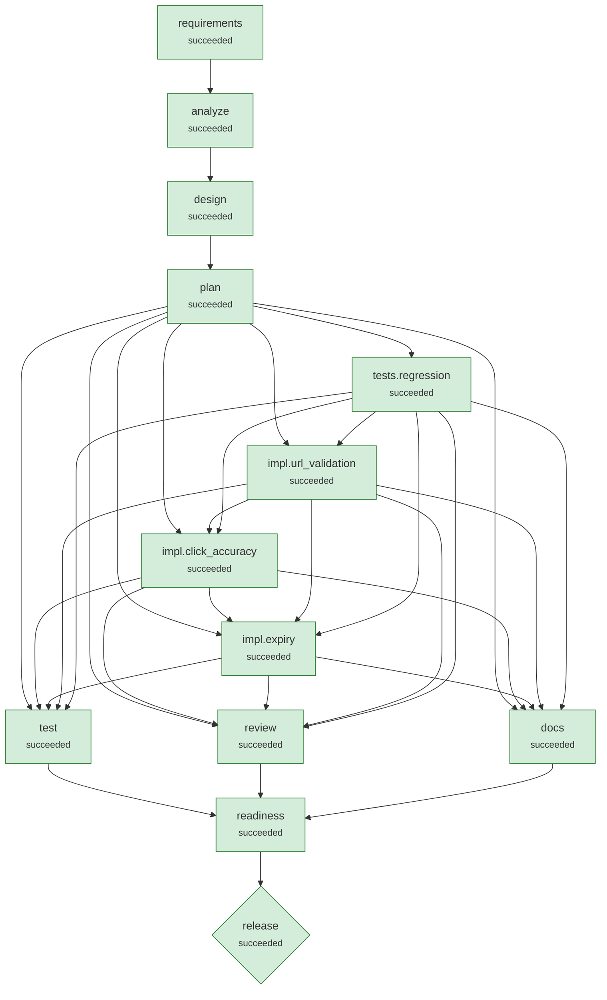

# Run llm-brownfield

**Scenario:** brownfield: linkly v0.4 -> v0.5: security fix, click accuracy fix, link expiry  
**Status:** `succeeded`  
**Provider:** ollama · **Playbook:** linkly

## 1. Requirement

```text
LINK-142 (security, P1): Pen test found that POST /shorten accepts javascript: and data: URLs, which become stored XSS when the short link is opened. Reject unsafe URLs with 400.
LINK-151 (bug): Marketing reports click counts are under-reported compared with their campaign tool, especially during launches.
LINK-150 (feature): Allow an optional expiry in days when creating a link; expired links must return 410 Gone.
Constraints: existing clients and the production database (v0.4 schema, live data) must keep working.
```

## 2. Requirement understanding

| Capability | Evidence in request | Acceptance criteria |
|---|---|---|
| click_accuracy | LINK-151 (bug): Marketing reports click counts are under-reported compared with their campaign tool, especially during launches. | Concurrent clicks are all counted (atomic increment)<br>Redirects are not permanently cacheable, so repeat clicks reach the service |
| expiry | LINK-150 (feature): Allow an optional expiry in days when creating a link; expired links must return 410 Gone. | Links may carry an optional expiry in the future<br>Expired links return 410 Gone |
| url_safety | LINK-142 (security, P1): Pen test found that POST /shorten accepts javascript: and data: URLs, which become stored XSS when the short link is opened. | Only http(s) targets are accepted; script/data/file schemes are rejected with 400<br>URLs with embedded credentials are rejected |

## 3. Codebase reasoning (brownfield)

- Import graph: `{'linkly': [], 'linkly.main': ['linkly', 'linkly.store'], 'linkly.store': []}`
- Blast radius: ['linkly.main', 'linkly.store']
- Data at risk: ['urls']
- Regression tests selected: ['tests/test_api.py']

| Capability | Modules | Routes | Tables |
|---|---|---|---|
| click_accuracy | ['linkly.main', 'linkly.store'] | ['GET /r/{code}'] | ['urls'] |
| expiry | ['linkly.main', 'linkly.store'] | ['GET /info/{code}', 'GET /r/{code}'] | ['urls'] |
| url_safety | ['linkly.main', 'linkly.store'] | ['POST /shorten'] | ['urls'] |

**Latent defects found by static analysis**

- `linkly.main.go`: cacheable-redirect: 301 is cached by browsers; repeat clicks never reach the server
- `linkly.store.create`: enumerable-ids: codes derived from sequential row ids can be enumerated
- `linkly.store.hit`: lost-update: reads then writes 'clicks' non-atomically

## 4. Design

Style: modular monolith: api -> service -> repository -> db, pure helpers below

| ADR | Decision | Rationale | Alternatives |
|---|---|---|---|
| ADR-01 | Atomic UPDATE ... SET clicks = clicks + 1 and 302 redirects | Fixes lost updates under concurrency and browser-cached 301s that never re-hit the service. | Row locking with SELECT ... FOR UPDATE (not in SQLite) |
| ADR-02 | Expiry evaluated at read time; 410 Gone | No background job required; expired rows remain for audit/analytics. | Background purge job |
| ADR-03 | Validate targets at the boundary; never fetch them | Blocks script schemes, credential spoofing and internal hosts without network I/O. | Fetch-and-inspect targets (SSRF risk, latency) |

## 5. Plan (v1) and decomposition

| Task | Agent | Depends on | Writes | Verified by | Declared impact |
|---|---|---|---|---|---|
| tests.regression | test_author | - | tests/test_validation.py, tests/test_clicks.py, tests/test_expiry.py, tests/test_migration.py | - | low |
| impl.url_validation | implement.llm | tests.regression | linkly/validation.py, linkly/main.py | tests/test_api.py, tests/test_validation.py | low |
| impl.click_accuracy | implement.llm | impl.url_validation, tests.regression | linkly/store.py, linkly/main.py | tests/test_api.py, tests/test_clicks.py | low |
| impl.expiry | implement.llm | impl.click_accuracy, impl.url_validation, tests.regression | linkly/store.py, linkly/main.py | tests/test_api.py, tests/test_expiry.py, tests/test_migration.py | low |

**Traceability (capability → tasks)**

- click_accuracy: ['tests.regression', 'impl.click_accuracy']
- expiry: ['tests.regression', 'impl.expiry']
- url_safety: ['tests.regression', 'impl.url_validation']

## 6. Orchestration graph



Rectangles are stages/tasks; diamonds are high-impact nodes that require human approval.

## 7. Execution

| Node | Kind | Status | Attempts | Runs | Origin | Started | Finished | Note |
|---|---|---|---|---|---|---|---|---|
| requirements | stage | succeeded | 1 | 1 | scenario | 18:45:50 | 18:45:59 |  |
| analyze | stage | succeeded | 1 | 1 | scenario | 18:45:59 | 18:45:59 |  |
| design | stage | succeeded | 1 | 1 | scenario | 18:45:59 | 18:45:59 |  |
| plan | stage | succeeded | 1 | 1 | scenario | 18:45:59 | 18:45:59 |  |
| tests.regression | task | succeeded | 1 | 1 | plan:v1 | 18:45:59 | 18:45:59 |  |
| impl.url_validation | task | succeeded | 2 | 1 | plan:v1 | 18:45:59 | 18:46:53 |  |
| impl.click_accuracy | task | succeeded | 2 | 1 | plan:v1 | 18:46:53 | 18:48:12 |  |
| impl.expiry | task | succeeded | 2 | 1 | plan:v1 | 18:48:12 | 18:49:54 |  |
| docs | stage | succeeded | 1 | 1 | scenario | 18:49:54 | 18:49:57 |  |
| review | stage | succeeded | 1 | 1 | scenario | 18:49:54 | 18:49:57 |  |
| test | stage | succeeded | 1 | 1 | scenario | 18:49:54 | 18:49:57 |  |
| readiness | stage | succeeded | 1 | 1 | scenario | 18:49:57 | 18:49:57 |  |
| release | stage | succeeded | 1 | 1 | scenario | 18:49:57 | 18:50:00 |  |

**Timeline (audit trail excerpts)**

- `18:45:50` **run.session.start**  {"status": "created"}
- `18:45:50` **attempt.start** requirements {"attempt": 1, "agent": "requirements.llm"}
- `18:45:59` **agent.note** requirements {"note": "model suggested ['click_accuracy', 'url_safety']"}
- `18:45:59` **attempt.start** analyze {"attempt": 1, "agent": "codebase"}
- `18:45:59` **agent.note** analyze {"note": "blast radius ['linkly.main', 'linkly.store'], 3 latent defects, regression tests ['tests/test_api.py']"}
- `18:45:59` **attempt.start** design {"attempt": 1, "agent": "design"}
- `18:45:59` **attempt.start** plan {"attempt": 1, "agent": "planner"}
- `18:45:59` **agent.note** plan {"note": "4 tasks; waiting on nothing"}
- `18:45:59` **plan.created** plan {"plan_version": 1, "added": ["tests.regression", "impl.url_validation", "impl.click_accuracy", "impl.expiry"], "changed": [], "removed": [], "reused": []}
- `18:45:59` **attempt.start** tests.regression {"attempt": 1, "agent": "test_author"}
- `18:45:59` **agent.note** tests.regression {"note": "candidate 1/1: Author regression tests for LINK-142/150/151 before touching code (test-first)"}
- `18:45:59` **change.applied** tests.regression {"digest": "57942118a4ccdc04", "summary": "Author regression tests for LINK-142/150/151 before touching code (test-first)", "candidate": 0, "paths": ["tests/test_clicks.py", "tests/test_expiry.py", "tests/test_migration.
- `18:45:59` **attempt.start** impl.url_validation {"attempt": 1, "agent": "implement.llm"}
- `18:46:50` **agent.note** impl.url_validation {"note": "model change: This solution implements URL validation at the API boundary to reject script, data, and credential URLs. It updates the `validate_url` function in `linkly/validation.py` to raise an `InvalidURL` e
- `18:46:50` **change.applied** impl.url_validation {"digest": "bf399ae006788ac5", "summary": "This solution implements URL validation at the API boundary to reject script, data, and credential URLs. It updates the `validate_url` function in `linkly/validation.py` to rais
- `18:46:51` **change.rolled_back** impl.url_validation {"paths": ["linkly/main.py", "linkly/validation.py"]}
- `18:46:51` **attempt.retry** impl.url_validation {"next_attempt": 2, "reason": "lint:   |\n1 | from urllib.parse import urlparse\n  | ^^^^^^^^^^^^^^^^^^^^^^^^^^^^^^^^^\n2 |\n3 | class InvalidURL(Exception):\n  |\nhelp: Organize imports\n  |\n2 |\n3 +\n4 | class Invalid
- `18:46:51` **attempt.start** impl.url_validation {"attempt": 2, "agent": "implement"}
- `18:46:51` **agent.note** impl.url_validation {"note": "candidate 1/1: LINK-142: reject script/data/credential URLs at the API boundary (extract validation module) (previous attempt failed: lint:   |\n1 | from urllib.parse import urlparse\n  | ^^^^^^^^^^^^^^^^^^^^^^
- `18:46:51` **change.applied** impl.url_validation {"digest": "a84391a1e917b24f", "summary": "LINK-142: reject script/data/credential URLs at the API boundary (extract validation module)", "candidate": 0, "paths": ["linkly/main.py", "linkly/validation.py"], "added": 37, 
- `18:46:53` **attempt.start** impl.click_accuracy {"attempt": 1, "agent": "implement.llm"}
- `18:48:09` **agent.note** impl.click_accuracy {"note": "model change: The provided code already meets the requirements for atomic click increment and 302 redirects with 'no-store' header. No changes are necessary."}
- `18:48:09` **change.applied** impl.click_accuracy {"digest": "513c93ac2593b289", "summary": "The provided code already meets the requirements for atomic click increment and 302 redirects with 'no-store' header. No changes are necessary.", "candidate": 0, "paths": ["link
- `18:48:10` **change.rolled_back** impl.click_accuracy {"paths": ["linkly/main.py", "linkly/store.py"]}
- `18:48:10` **attempt.retry** impl.click_accuracy {"next_attempt": 2, "reason": "tests: ['tests/test_api.py', 'tests/test_clicks.py']: 1 failed, 4 passed in 0.33s | ['FAILED tests/test_clicks.py::test_redirect_is_not_permanently_cacheable - Key...']"}
- `18:48:10` **attempt.start** impl.click_accuracy {"attempt": 2, "agent": "implement"}
- `18:48:10` **agent.note** impl.click_accuracy {"note": "candidate 1/1: LINK-151: atomic click increment; 302 + no-store so browsers stop caching redirects (previous attempt failed: tests: ['tests/test_api.py', 'tests/test_clicks.py']: 1 failed, 4 passed in 0.33s | [
- `18:48:10` **change.applied** impl.click_accuracy {"digest": "62929c09a62276d7", "summary": "LINK-151: atomic click increment; 302 + no-store so browsers stop caching redirects", "candidate": 0, "paths": ["linkly/main.py", "linkly/store.py"], "added": 7, "removed": 4}
- `18:48:12` **attempt.start** impl.expiry {"attempt": 1, "agent": "implement.llm"}
- `18:49:50` **agent.note** impl.expiry {"note": "model change: The provided code does not include the necessary changes to pass the acceptance tests. The tests require the implementation of link expiry, handling of expired links, and in-place schema migration
- `18:49:50` **policy.blocked** impl.expiry {"reason": "SEC-000 linkly/store.py: does not parse: unterminated string literal (detected at line 22) (line 22)"}
- `18:49:50` **attempt.retry** impl.expiry {"next_attempt": 2, "reason": "policy blocked: SEC-000 linkly/store.py: does not parse: unterminated string literal (detected at line 22) (line 22)"}
- `18:49:51` **attempt.start** impl.expiry {"attempt": 2, "agent": "implement"}
- `18:49:51` **agent.note** impl.expiry {"note": "candidate 2/2: Same change plus an idempotent ALTER TABLE migration for existing databases (previous attempt failed: policy blocked: SEC-000 linkly/store.py: does not parse: unterminated string literal (detecte
- `18:49:51` **change.applied** impl.expiry {"digest": "df7dd753712dbf5c", "summary": "Same change plus an idempotent ALTER TABLE migration for existing databases", "candidate": 1, "paths": ["linkly/main.py", "linkly/store.py"], "added": 26, "removed": 5}
- `18:49:52` **approval.requested** impl.expiry {"subject": "df7dd753712dbf5c", "reasons": ["DATA-001 linkly/store.py: schema change against an existing database"]}
- `18:49:52` **node.waiting** impl.expiry {"reason": "approval required: DATA-001 linkly/store.py: schema change against an existing database"}
- `18:49:52` **run.session.end**  {"status": "waiting", "stop_reason": null, "waiting": ["impl.expiry"]}
- `18:49:52` **approval.decided** impl.expiry {"subject": "df7dd753712dbf5c", "status": "approved", "by": "reviewer", "comment": "migration verified by the v0.4 upgrade test", "decided_at": 1791312592.7449536, "waited_s": 0.4}
- `18:49:53` **run.session.start**  {"status": "waiting"}
- `18:49:54` **attempt.start** docs {"attempt": 1, "agent": "docs"}
- `18:49:54` **attempt.start** review {"attempt": 1, "agent": "reviewer"}
- `18:49:54` **attempt.start** test {"attempt": 1, "agent": "test_runner"}
- `18:49:55` **agent.note** review {"note": "0 lint, 0 security, 1 latent defects (reported, non-blocking)"}
- `18:49:57` **agent.note** test {"note": "22 passed, 0 failed, coverage 99.0%"}
- `18:49:57` **change.applied** docs {"digest": "6b5b34907dc1ea7e", "summary": "Generate API reference, design record, changelog", "candidate": 0, "paths": ["CHANGELOG.md", "docs/API.md", "docs/DESIGN.md", "openapi.json"], "added": 248, "removed": 0}
- `18:49:57` **attempt.start** readiness {"attempt": 1, "agent": "release_readiness"}
- `18:49:57` **agent.note** readiness {"note": "ready=True, 1 residual risks"}
- `18:49:57` **attempt.start** release {"attempt": 1, "agent": "release"}
- `18:49:57` **change.applied** release {"digest": "16b732d5dda11f03", "summary": "Release 0.5.0", "candidate": 0, "paths": ["RELEASE_NOTES.md", "VERSION", "pyproject.toml"], "added": 25, "removed": 1}
- `18:49:58` **approval.requested** release {"subject": "16b732d5dda11f03", "reasons": ["high-impact stage 'release'", "CHG-002 pyproject.toml: modifies a protected file"]}
- `18:49:58` **node.waiting** release {"reason": "approval required: high-impact stage 'release'; CHG-002 pyproject.toml: modifies a protected file"}
- `18:49:58` **run.session.end**  {"status": "waiting", "stop_reason": null, "waiting": ["release"]}
- `18:49:58` **approval.decided** release {"subject": "16b732d5dda11f03", "status": "approved", "by": "reviewer", "comment": "", "decided_at": 1791312598.8531902, "waited_s": 0.4}
- `18:49:59` **run.session.start**  {"status": "waiting"}
- `18:50:00` **run.session.end**  {"status": "succeeded", "stop_reason": null, "waiting": []}

## 8. Validation gates

| Node | Type | Gate | Result | Detail |
|---|---|---|---|---|
| requirements | exit | requirements_valid | pass | 3 capabilities, all with acceptance criteria |
| design | exit | design_covers_requirements | pass | every capability has a design element |
| plan | exit | plan_valid | pass | 4 tasks; every capability traced to >=1 task |
| tests.regression | exit | compiles | pass | 4 files compile |
| tests.regression | exit | lint | pass | ruff clean |
| impl.url_validation | exit | compiles | pass | 2 files compile |
| impl.url_validation | exit | lint | FAIL |   \| 1 \| from urllib.parse import urlparse   \| ^^^^^^^^^^^^^^^^^^^^^^^^^^^^^^^^^ 2 \| 3 \| class InvalidURL(Exception):   \| help: Organize imports   \| 2  |
| impl.url_validation | exit | tests | FAIL | ['tests/test_api.py', 'tests/test_validation.py']: b-agentic-sdlc/runs/llm-brownfield/workspace/tests/conftest.py'. tests/conftest.py:4: in <module>   |
| impl.url_validation | exit | compiles | pass | 2 files compile |
| impl.url_validation | exit | lint | pass | ruff clean |
| impl.url_validation | exit | tests | pass | ['tests/test_api.py', 'tests/test_validation.py']: 15 passed in 0.13s |
| impl.click_accuracy | exit | compiles | pass | 2 files compile |
| impl.click_accuracy | exit | lint | pass | ruff clean |
| impl.click_accuracy | exit | tests | FAIL | ['tests/test_api.py', 'tests/test_clicks.py']: 1 failed, 4 passed in 0.33s \| ['FAILED tests/test_clicks.py::test_redirect_is_not_permanently_cacheable |
| impl.click_accuracy | exit | compiles | pass | 2 files compile |
| impl.click_accuracy | exit | lint | pass | ruff clean |
| impl.click_accuracy | exit | tests | pass | ['tests/test_api.py', 'tests/test_clicks.py']: 5 passed in 0.23s |
| impl.expiry | exit | compiles | pass | 2 files compile |
| impl.expiry | exit | lint | pass | ruff clean |
| impl.expiry | exit | tests | pass | ['tests/test_api.py', 'tests/test_expiry.py', 'tests/test_migration.py']: 8 passed in 0.17s |
| impl.expiry | exit | compiles | pass | 2 files compile |
| impl.expiry | exit | lint | pass | ruff clean |
| impl.expiry | exit | tests | pass | ['tests/test_api.py', 'tests/test_expiry.py', 'tests/test_migration.py']: 8 passed in 0.17s |
| docs | exit | openapi_valid | pass | 3 operations; all designed endpoints present |
| docs | exit | docs_complete | pass | 4 docs written |
| review | exit | lint_clean | pass | no lint issues |
| review | exit | security_clean | pass | no security findings |
| test | exit | tests_pass | pass | 22 passed, 0 failed, 0 errors |
| test | exit | coverage_min | pass | coverage 99.0% (min 85.0%) |
| readiness | exit | readiness | pass | all release checks pass |
| release | exit | smoke | pass | ok POST /shorten -> 200 ok GET /r/1 -> 302 ok POST /shorten -> 400 ok GET /info/1 -> 200 |
| release | exit | smoke | pass | ok POST /shorten -> 200 ok GET /r/2 -> 302 ok POST /shorten -> 400 ok GET /info/2 -> 200 |

## 9. Policy guardrails

| Node | Rule | Severity | Path | Message |
|---|---|---|---|---|
| impl.expiry | DATA-001 | approve | linkly/store.py | schema change against an existing database |
| impl.expiry | SEC-000 | block | linkly/store.py | does not parse: unterminated string literal (detected at line 22) (line 22) |
| impl.expiry | DATA-001 | approve | linkly/store.py | schema change against an existing database |
| release | CHG-002 | approve | pyproject.toml | modifies a protected file |

## 10. Human approvals

| Node | Subject | Reasons | Decision | By | Waited (s) |
|---|---|---|---|---|---|
| impl.expiry | df7dd753712dbf5c | DATA-001 linkly/store.py: schema change against an existing database | approved | reviewer | 0.4 |
| release | 16b732d5dda11f03 | high-impact stage 'release'<br>CHG-002 pyproject.toml: modifies a protected file | approved | reviewer | 0.4 |

## 11. Decision log (lineage)

| Id | Node | By | Decision | Rationale | Inputs |
|---|---|---|---|---|---|
| D001 | analyze | agent | Sequential/enumerable codes noted but left out of scope | Changing code generation alters every future URL format and is not requested by LINK-142/150/151; raised as a follow-up risk instead. | {'requirements': 1} |
| D002 | design | agent | Atomic UPDATE ... SET clicks = clicks + 1 and 302 redirects | Fixes lost updates under concurrency and browser-cached 301s that never re-hit the service. | {'requirements': 1, 'impact_analysis': 1} |
| D003 | design | agent | Expiry evaluated at read time; 410 Gone | No background job required; expired rows remain for audit/analytics. | {'requirements': 1, 'impact_analysis': 1} |
| D004 | design | agent | Validate targets at the boundary; never fetch them | Blocks script schemes, credential spoofing and internal hosts without network I/O. | {'requirements': 1, 'impact_analysis': 1} |
| D005 | plan | agent | Serialise impl.click_accuracy after impl.url_validation | Both change ['linkly/main.py']; running them in parallel could produce conflicting edits, so they are ordered like a merge queue. | {'requirements': 1, 'impact_analysis': 1, 'design': 1} |

### test_report

```json
{
 "passed": 22,
 "failed": 0,
 "errors": 0,
 "skipped": 0,
 "total": 22,
 "ok": true,
 "coverage": 99.0,
 "failures": []
}
```

### review_report

```json
{
 "lint": [],
 "security": [],
 "latent_defects": [
  {
   "function": "create",
   "kind": "enumerable-ids",
   "detail": "codes derived from sequential row ids can be enumerated",
   "module": "linkly.store"
  }
 ]
}
```

### release_readiness

```json
{
 "checks": [
  {
   "check": "all tests pass",
   "passed": true,
   "detail": "22 passed / 0 failed"
  },
  {
   "check": "coverage >= 85%",
   "passed": true,
   "detail": "99.0%"
  },
  {
   "check": "lint clean",
   "passed": true,
   "detail": "0 issues"
  },
  {
   "check": "no security findings",
   "passed": true,
   "detail": "0 findings"
  },
  {
   "check": "docs generated",
   "passed": true,
   "detail": "openapi.json, docs/API.md, docs/DESIGN.md, CHANGELOG.md"
  },
  {
   "check": "no blocking questions open",
   "passed": true,
   "detail": "[]"
  }
 ],
 "ready": true,
 "residual_risks": [
  "linkly.store.create: codes derived from sequential row ids can be enumerated"
 ]
}
```

## 12. Artifact lineage

Provenance of `release`:

- release v1 ← release
  - plan v1 ← plan
    - design v1 ← design
      - impact_analysis v1 ← analyze
        - requirements v1 ← requirements
          - human_answers v1 ← scenario
          - requirement_text v1 ← scenario
  - release_readiness v1 ← readiness
    - docs v1 ← docs
    - review_report v1 ← review
    - test_report v1 ← test

## 13. Reliability metrics

| Metric | Value |
|---|---|
| nodes_succeeded | 13 |
| nodes_failed | 0 |
| node_success_rate | 1.0 |
| attempts | 14 |
| attempt_success_rate | 0.786 |
| retries | 3 |
| changes_applied | 8 |
| rollbacks | 2 |
| rollback_rate | 0.25 |
| mttr_s | 1.396 |
| recoveries | 3 |
| replans | 0 |
| invalidations | 0 |
| reused_nodes | 0 |
| policy_blocks | 1 |
| approvals | 2 |
| approval_wait_s | 0.4 |
| active_time_s | 247.953 |
| wall_time_s | 250.23 |
| sessions | 3 |
| llm_tokens | 8173 |

Audit chain: **verified** (129 records, chain intact).

## 14. Change sets

Every applied change (including rolled-back attempts) is kept in `changes/`:

- `changes/docs.a1.diff`
- `changes/impl.click_accuracy.a1.diff`
- `changes/impl.click_accuracy.a2.diff`
- `changes/impl.expiry.a2.diff`
- `changes/impl.url_validation.a1.diff`
- `changes/impl.url_validation.a2.diff`
- `changes/release.a1.diff`
- `changes/tests.regression.a1.diff`
